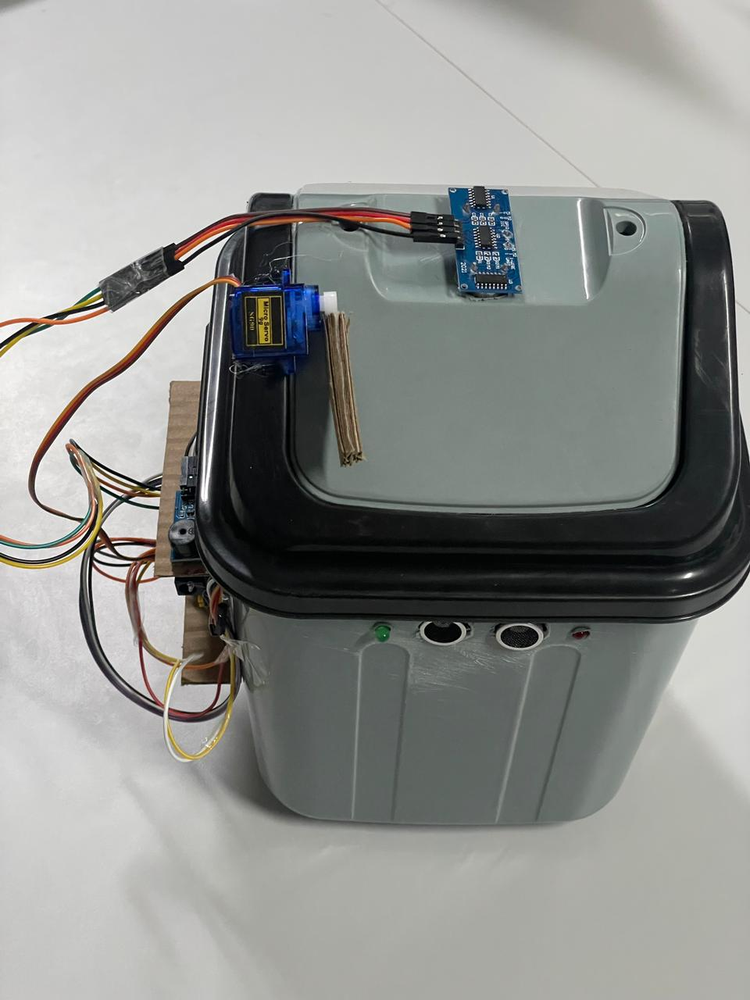
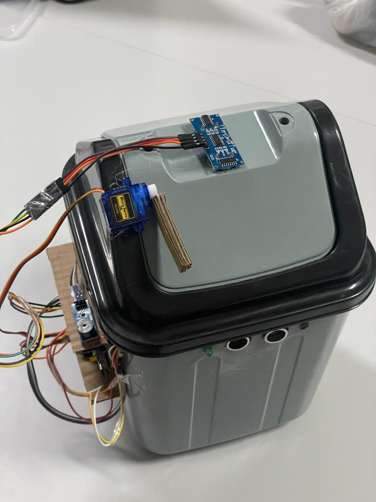
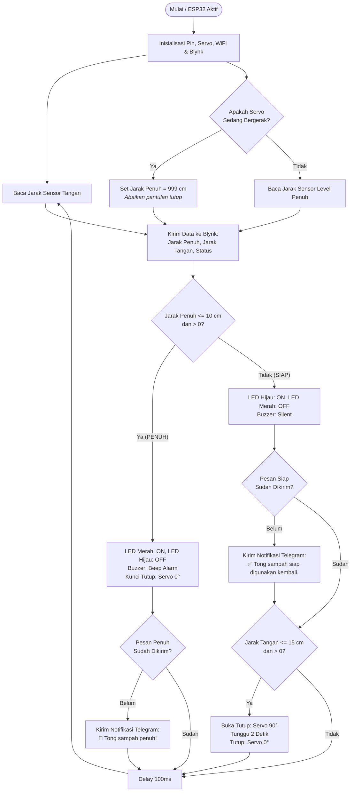

# Smart Trash Bin IoT (ESP32)

> Proyek ini dikembangkan untuk memenuhi kebutuhan tugas mata kuliah **Internet of Things (IoT)**.

Proyek **Smart Trash Bin** adalah sistem tempat sampah pintar berbasis mikrokontroler **ESP32** yang dilengkapi dengan mekanisme buka-tutup otomatis (*touchless*), pemantauan kapasitas/volume sampah secara *real-time*, indikator audio-visual, serta integrasi **IoT** menggunakan **Blynk** dan **Telegram Bot**.

---

## 👥 Tim Pengembang

Proyek ini dirancang dan dikembangkan oleh:

| No | Nama Anggota | NRP / NIM |
|:--:|---|:---:|
| 1 | **Mayzendhy Putra Arinda** | `5323600007` |
| 2 | **Moh Satria Halim Wicaksana** | `5323600010` |
| 3 | **Farchan Deano Muhammad** | `5323600012` |
| 4 | **Rakha Zahran Andrian** | `5323600014` |
| 5 | **Hanan Hafizhah Zarkasi** | `5323600015` |
| 6 | **Herlina Dewi Yanti** | `5323600026` |
| 7 | **Harish Imaduddin Mukhlis** | `5323600028` |

---

## 📷 Dokumentasi Proyek

| Dokumentasi 1 (Tampak Depan) | Dokumentasi 2 (Tampak Atas & Mekanisme) |
| :---: | :---: |
|  |  |

> 📖 **Dokumentasi Lengkap:**  
> Ulasan mendalam mengenai desain sistem, skematik wiring prototipe, display final, dan pengujian notifikasi Telegram dapat dilihat di [assets/Dokumentasi.md](assets/Dokumentasi.md).

---

1. **Buka-Tutup Otomatis (Nirsentuh / Touchless)**
   - Menggunakan sensor ultrasonik tangan untuk mendeteksi keberadaan tangan pada jarak $\le 15\text{ cm}$.
   - Motor servo akan membuka tutup tempat sampah secara otomatis selama 2 detik lalu menutup kembali.

2. **Deteksi Kapasitas Sampah (Monitoring Level)**
   - Menggunakan sensor ultrasonik kedua untuk mendeteksi ketinggian isi sampah di dalam wadah.
   - Jika jarak permukaan sampah $\le 10\text{ cm}$, tempat sampah dikategorikan **PENUH**.

3. **Sistem Keamanan & Penguncian Otomatis (Safety Lock)**
   - Saat tempat sampah berstatus **PENUH**, servo dinonaktifkan/dikunci pada posisi tertutup ($0^\circ$) agar pengguna tidak memaksakan membuang sampah lagi.
   - Dilengkapi logika *anti-false trigger*: pembacaan sensor level sampah dinonaktifkan sementara saat servo bergerak untuk menghindari pantulan gerakan tutup.

4. **Indikator Audio & Visual**
   - **Kondisi Normal / Siap Digunakan**: LED Hijau menyala, LED Merah mati, Buzzer nonaktif.
   - **Kondisi Penuh**: LED Merah menyala, LED Hijau mati, Buzzer berbunyi secara intermiten (*beep-beep*).

5. **Konektivitas IoT & Monitoring Jarak Jauh (Blynk)**
   - Mengirim status dan data jarak real-time ke aplikasi **Blynk**.

6. **Notifikasi Otomatis via Telegram**
   - Mengirim pesan peringatan otomatis ke Telegram saat tempat sampah penuh:  
     `🚮 Tong sampah penuh! Segera dikosongkan.`
   - Mengirim pesan konfirmasi saat tempat sampah telah dikosongkan dan siap digunakan:  
     `✅ Tong sampah siap digunakan kembali.`

---

## 🛠️ Kebutuhan Komponen Hardware

| No | Komponen | Jumlah | Deskripsi / Spesifikasi |
|---|---|---|---|
| 1 | **ESP32 Dev Module** | 1 | Mikrokontroler utama dengan WiFi terintegrasi |
| 2 | **Sensor Ultrasonik (HC-SR04 / HC-SR04P)** | 2 | 1x untuk deteksi tangan, 1x untuk deteksi kapasitas |
| 3 | **Micro Servo (SG90 / MG90S)** | 1 | Penggerak mekanik tutup tempat sampah |
| 4 | **Buzzer** | 1 | Buzzer aktif/pasif sebagai alarm audio saat penuh |
| 5 | **LED Merah (5mm)** | 1 | Indikator visual saat tempat sampah penuh |
| 6 | **LED Hijau (5mm)** | 1 | Indikator visual saat tempat sampah siap/kosong |
| 7 | **Resistor 220Ω / 330Ω** | 2 | Resistor pembatas arus untuk LED |
| 8 | **Power Supply / Adaptor 5V (2A)** | 1 | Catu daya ESP32 dan servo |
| 9 | **Breadboard & Kabel Jumper** | Secukupnya | Kabel penghubung rangkaian |

---

## 🔌 Tabel Wiring (Skema Sambungan Pin)

| Komponen | Pin Komponen | Pin ESP32 (GPIO) | Keterangan / Fungsi |
|---|---|---|---|
| **Sensor Ultrasonik Tangan (HC-SR04)** | VCC | **5V (VIN)** | Catu daya sensor |
| | GND | **GND** | Ground |
| | TRIG | **GPIO 5** | Trigger sinyal ultrasonik tangan |
| | ECHO | **GPIO 18** | Echo pantulan sinyal ultrasonik tangan |
| **Sensor Ultrasonik Level Sampah (HC-SR04)** | VCC | **5V (VIN)** | Catu daya sensor |
| | GND | **GND** | Ground |
| | TRIG | **GPIO 4** | Trigger sinyal deteksi kapasitas sampah |
| | ECHO | **GPIO 2** | Echo pantulan sinyal kapasitas sampah |
| **Motor Servo (SG90 / MG90S)** | VCC (Kabel Merah) | **5V (VIN / Eksternal)** | Tegangan daya motor servo |
| | GND (Kabel Cokelat/Hitam) | **GND** | Ground bersama (*common ground*) |
| | Signal (Kabel Oranye/Kuning) | **GPIO 13** | Kontrol PWM posisi sudut servo |
| **Buzzer** | VCC / Anoda (+) | **GPIO 14** | Sinyal audio alarm nada frekuensi |
| | GND / Katoda (-) | **GND** | Ground |
| **LED Merah** | Anoda (+) | **GPIO 25** *(via Resistor 220Ω)* | Indikator kondisi tempat sampah PENUH |
| | Katoda (-) | **GND** | Ground |
| **LED Hijau** | Anoda (+) | **GPIO 26** *(via Resistor 220Ω)* | Indikator kondisi tempat sampah NORMAL/SIAP |
| | Katoda (-) | **GND** | Ground |

> [!TIP]
> **Catatan Kelistrikan:**
> - Motor servo membutuhkan lonjakan arus saat bergerak. Jika ESP32 mengalami *brownout / restart* tiba-tiba saat servo aktif, gunakan sumber daya 5V eksternal terpisah untuk servo dengan **GND yang tetap terhubung bersama (*common ground*)** ke ESP32.
> - Pin Echo pada modul HC-SR04 standar (5V) mengeluarkan sinyal logika 5V. Disarankan menggunakan modul **HC-SR04P** (kompatibel 3.3V) atau menggunakan pembagi tegangan (*voltage divider* resistor 1kΩ & 2kΩ) pada pin Echo menuju pin input ESP32 untuk proteksi jangka panjang.

---

## 📱 Konfigurasi Blynk IoT

Aplikasi Blynk digunakan untuk memantau status tempat sampah secara *real-time*.

### Data Stream / Virtual Pin Mapping:

| Virtual Pin | Nama Datastream | Tipe Data | Nilai / Keterangan |
|---|---|---|---|
| **V0** | Status | String | `"PENUH"` atau `"TIDAK PENUH"` |
| **V1** | Jarak Penuh | Integer / Float | Jarak permukaan sampah ke sensor (cm) |
| **V2** | Jarak Tangan | Integer / Float | Jarak tangan ke sensor luar (cm) |

---

## 🔄 Alur Logika Sistem (Flowchart)



---

## ⚙️ Panduan Pengaturan & Konfigurasi

Sebelum mengunggah kode ke ESP32, sesuaikan konfigurasi kredensial pada berkas [Smart-TrashBin.ino](Smart-TrashBin.ino):

```cpp
// =====================================
// BLYNK CONFIG
// =====================================
#define BLYNK_TEMPLATE_ID   "YOUR_BLYNK_TEMPLATE_ID"
#define BLYNK_TEMPLATE_NAME "Smart Trashbin"
#define BLYNK_AUTH_TOKEN    "YOUR_BLYNK_AUTH_TOKEN"

// =====================================
// KREDENSIAL WIFI
// =====================================
char ssid[] = "NAMA_WIFI_ANDA";
char pass[] = "PASSWORD_WIFI_ANDA";

// =====================================
// TELEGRAM BOT
// =====================================
String BOT_TOKEN = "YOUR_TELEGRAM_BOT_TOKEN";
String CHAT_ID   = "YOUR_TELEGRAM_CHAT_ID";
```

> [!CAUTION]
> **Catatan Penting!:**  
> Jangan membagikan atau mengunggah Auth Token Blynk, Token Bot Telegram, atau password Wi-Fi Anda ke repositori publik (seperti GitHub publik).

---

## 🚀 Cara Menjalankan Proyek

### Opsi 1: Menggunakan Arduino IDE
1. Buka **Arduino IDE** dan pastikan board package **ESP32 by Espressif Systems** sudah terpasang.
2. Pasang pustaka (*library*) berikut melalui Library Manager (`Ctrl + Shift + I`):
   - **Blynk** by Volodymyr Shymanskyy
   - **ESP32Servo** by Kevin Harrington
3. Buka file [Smart-TrashBin.ino](Smart-TrashBin.ino).
4. Pilih board: **Tools > Board > ESP32 Arduino > ESP32 Dev Module**.
5. Pilih port COM yang sesuai: **Tools > Port**.
6. Klik **Upload**, lalu buka **Serial Monitor** pada kecepatan **115200 baud**.

### Opsi 2: Menggunakan PlatformIO (VS Code)
1. Buka folder proyek ini di VS Code yang telah memiliki ekstensi **PlatformIO IDE**.
2. Pastikan file [platformio.ini](platformio.ini) mengarah ke berkas sumber yang benar:
   ```ini
   [env:esp32dev]
   platform = espressif32
   board = esp32dev
   framework = arduino
   src_dir = .
   build_src_filter =
       +<Smart-TrashBin.ino>
   lib_deps =
       blynkkk/Blynk
       madhephaestus/ESP32Servo
   upload_speed = 460800
   monitor_speed = 115200
   ```
3. Klik tombol **Build** (`✓`) kemudian **Upload** (`→`).
4. Buka **Serial Monitor** (`monitor_speed = 115200`).

---

## 📂 Struktur Repositori

```text
IoT-TrashBin/
├── assets/                 # Berkas dokumentasi, desain, & foto pendukung
│   ├── Dokumentasi.md      # Laporan dokumentasi lengkap
│   ├── Dokumentasi1.jpeg   # Foto fisik tempat sampah (tampak depan)
│   ├── Dokumentasi2.jpeg   # Foto fisik tempat sampah (tampak atas & engsel)
│   ├── DesainSystem.png    # Diagram arsitektur sistem
│   ├── WiringPrototype.png # Skematik wiring prototipe
│   ├── NotifTele.jpeg      # Screenshot pengujian notifikasi Telegram
│   └── Prototype1.pdf      # Dokumen desain prototipe awal
├── README.md               # Dokumentasi utama proyek & tabel wiring
├── Smart-TrashBin.ino       # Source code utama ESP32 (Arduino sketch)
└── platformio.ini          # Konfigurasi build environment PlatformIO
```
