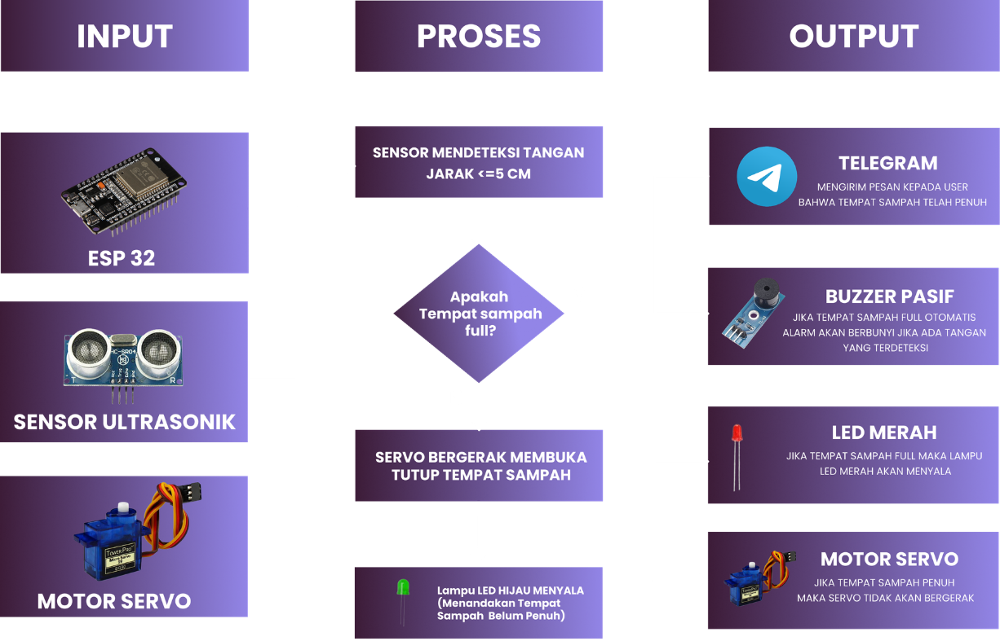
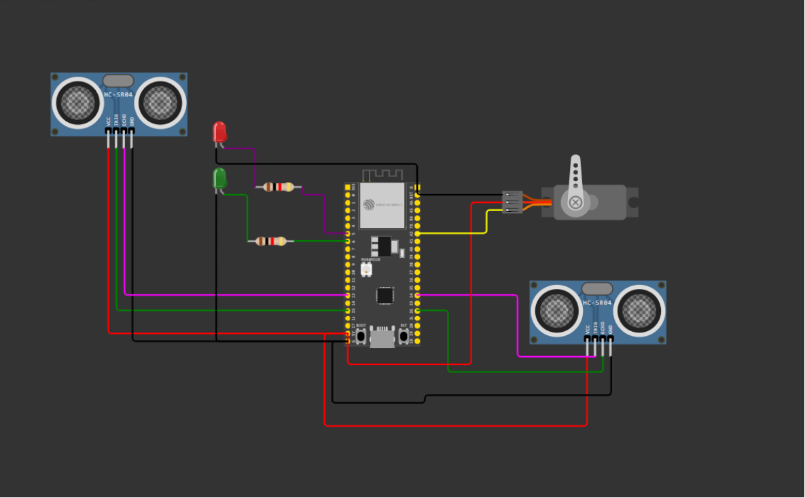
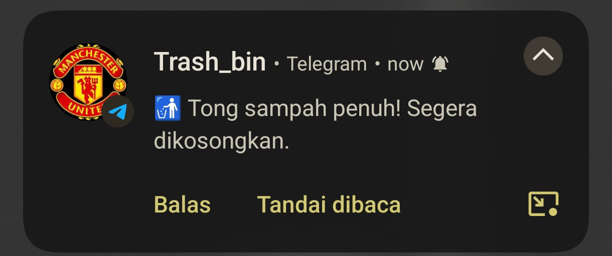

# 📖 Dokumentasi Proyek Smart Trash Bin IoT

Dokumentasi ini memuat catatan visual perancangan, desain arsitektur, skematik pengkabelan (*wiring prototype*), wujud fisik akhir (*final display*), serta pengujian notifikasi pada sistem **Smart Trash Bin berbasis ESP32**.

> [!NOTE]
> **Catatan Dokumentasi:**  
> Sebagian dokumentasi foto proses pengerjaan awal dan perakitan tahap per tahap mengalami kehilangan data (*missing files*). Namun, dokumentasi kunci yang mencakup **Desain Sistem**, **Skema Wiring Prototipe**, **Display Fisik Akhir Alat**, dan **Pengujian Notifikasi Telegram** terdokumentasi lengkap pada laporan ini.

---

## 1. 🏗️ Desain Sistem (System Architecture)

Desain sistem menggambarkan bagaimana komponen perangkat keras (*hardware*), mikrokontroler ESP32, dan layanan *cloud* (Blynk IoT & Telegram API) saling terhubung dan berkomunikasi.

### Penjelasan Blok Sistem:
1. **Input (Sensor)**:
   - **Sensor Ultrasonik 1 (HC-SR04 Tangan)**: Mendeteksi keberadaan tangan pengguna yang mendekat ($\le 15\text{ cm}$) untuk membuka tutup secara otomatis tanpa sentuhan.
   - **Sensor Ultrasonik 2 (HC-SR04 Level)**: Mengukur jarak ketinggian tumpukan sampah di dalam tong untuk menentukan apakah tong sudah penuh ($\le 10\text{ cm}$).
2. **Controller (ESP32)**:
   - Bertindak sebagai otak pemroses logika pembacaan jarak, kontrol aktuator (servo), indikator LED & buzzer, serta modul komunikasi WiFi.
3. **Output (Aktuator & Indikator)**:
   - **Motor Servo (SG90)**: Membuka sudut $90^\circ$ selama 2 detik saat ada tangan, dan terkunci pada sudut $0^\circ$ saat sampah penuh.
   - **LED Hijau & Merah**: Indikator status (Hijau = Siap/Kosong, Merah = Penuh).
   - **Buzzer**: Memberikan peringatan suara (*alarm beep*) saat sampah mencapai kapasitas maksimum.
4. **Cloud & Network Services**:
   - **Blynk IoT Server**: Menerima data telemetri jarak level sampah dan status tempat sampah secara *real-time*.
   - **Telegram Bot API**: Mengirimkan pesan push notification otomatis ke pengguna/petugas kebersihan.

---

## 2. 🔌 Skema Wiring Prototipe (Prototype Wiring Design)

Tahap perancangan rangkaian elektronik sebelum implementasi fisik ke dalam wadah tempat sampah.

### Rangkuman Sambungan Pin Prototipe:

| Modul / Komponen | Pin Komponen | Pin ESP32 (GPIO) | Fungsi Utama |
|---|---|---|---|
| **Ultrasonik Tangan** | TRIG / ECHO | **GPIO 5 / GPIO 18** | Deteksi tangan pengguna |
| **Ultrasonik Penuh** | TRIG / ECHO | **GPIO 4 / GPIO 2** | Deteksi ketinggian sampah |
| **Motor Servo** | Signal (PWM) | **GPIO 13** | Penggerak buka-tutup |
| **Buzzer** | Positif (+) | **GPIO 14** | Peringatan suara saat penuh |
| **LED Merah** | Anoda (+) | **GPIO 25** | Indikator visual penuh |
| **LED Hijau** | Anoda (+) | **GPIO 26** | Indikator visual siap pakai |

> [!TIP]
> Dokumen detail desain prototipe awal juga dapat diakses pada berkas lampiran: [Prototype1.pdf](Prototype1.pdf).

---

## 3. 🗑️ Display Fisik Final (Final Product Display)

Setelah pengujian pada *breadboard* berhasil, seluruh modul elektronika dan aktuator diintegrasikan ke dalam wadah tempat sampah secara kompak dan fungsional.

| Dokumentasi 1: Tampak Depan & Keseluruhan | Dokumentasi 2: Tampak Atas & Mekanisme Tutup |
| :---: | :---: |
|  |  |
| *Wujud fisik Smart Trash Bin siap beroperasi* | *Penempatan sensor ultrasonik & mekanisme engsel servo* |

### Karakteristik Penempatan Komponen:
- **Sensor Ultrasonik Depan**: Diposisikan pada bagian luar menghadap ke arah datangnya pengguna untuk mendeteksi gestur tangan secara responsif.
- **Sensor Ultrasonik Dalam**: Terpasang di bawah tutup menghadap lurus ke dasar tempat sampah untuk mengukur kapasitas isi secara akurat.
- **Motor Servo**: Dipasang langsung pada engsel tutup dengan *arm* servo yang mampu mendorong tutup hingga sudut $90^\circ$.
- **LED & Buzzer**: Ditempatkan di bagian luar agar mudah terlihat dan terdengar oleh pengguna.

---

## 4. 📲 Pengujian Notifikasi Telegram (Telegram Alert Test)

Pengujian dilakukan untuk memverifikasi fungsionalitas pengiriman pesan darurat ketika sampah telah memenuhi wadah ($\le 10\text{ cm}$).

### Hasil Pengujian:
- **Respon Waktu**: Notifikasi Telegram berhasil diterima dalam waktu $< 2$ detik setelah sensor mendeteksi kondisi penuh.
- **Pesan Otomatis**: Bot Telegram berhasil mengeksekusi pesan:  
  `🚮 Tong sampah penuh! Segera dikosongkan.`
- **Proteksi Penguncian**: Bersamaan dengan terkirimnya pesan ini, servo secara otomatis mengunci tutup sehingga pengguna lain tidak dapat memasukkan sampah lagi, dan buzzer berbunyi sebagai peringatan di lokasi.
- **Pemulihan Otomatis**: Ketika sampah telah dikeluarkan/dikosongkan, sistem mengirim pesan konfirmasi kembali bahwa tong siap digunakan (`✅ Tong sampah siap digunakan kembali.`).

---

## 5. 📝 Kesimpulan Dokumentasi

Integrasi antara desain sistem, skematik perkabelan, perakitan fisik, dan integrasi IoT telah teruji berjalan sesuai spesifikasi rancangan:
1. Sistem bekerja *touchless* untuk menjaga kebersihan dan higienitas.
2. Fitur *anti-false trigger* berhasil mencegah kesalahan baca saat tutup bergerak.
3. Notifikasi *real-time* ke Telegram Bot membantu efisiensi pemantauan tanpa harus mengecek tong secara manual.

---
